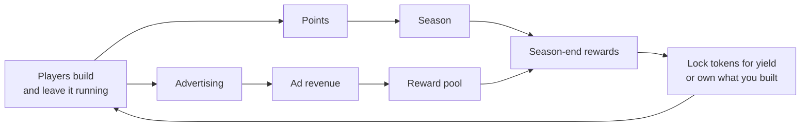
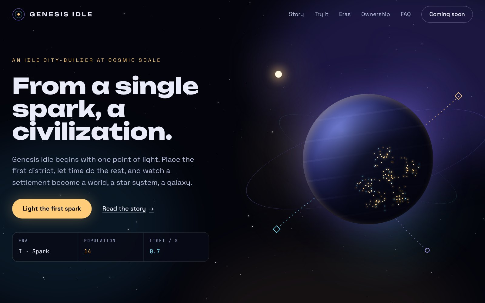
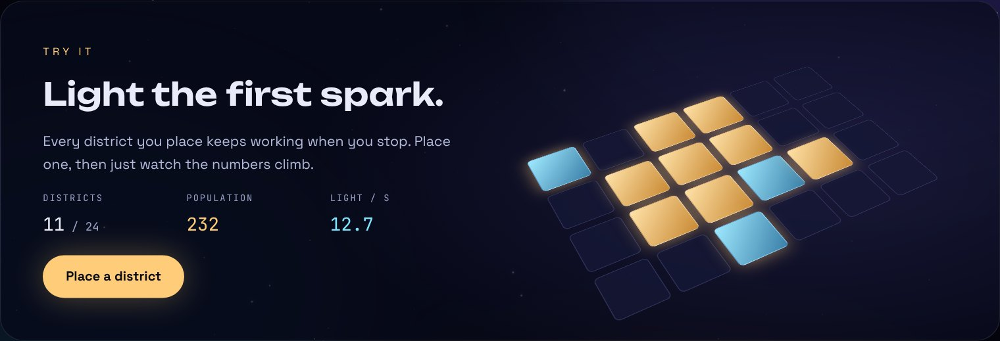
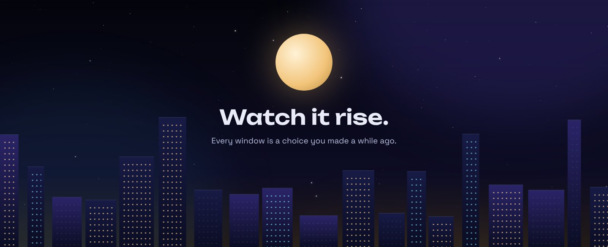
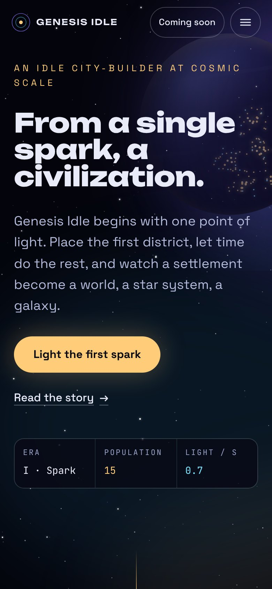

<p align="center">
  
</p>

# Genesis Idle

**From a single spark, a civilization.**

Genesis Idle is an idle tycoon and city-builder at cosmic scale. You place the first district, leave the game running, and come back to something larger than you left. Behind the game sits a bigger plan: an ecosystem in which play, advertising revenue and on-chain ownership feed one another.

[Website](https://genesisidle.com)

> **Status:** in development. The website and a small playable demo are live. The game itself has not launched, and everything under [The ecosystem](#the-ecosystem) is a plan, not a released product.

## Contents

- [The game](#the-game)
- [The ecosystem](#the-ecosystem)
- [Roadmap](#roadmap)
- [The website](#the-website)
- [Working with this repository](#working-with-this-repository)
- [Team](#team)
- [Rights](#rights)

## The game

### The idea

Idle games are about time. So are civilizations. Genesis Idle is built on one quiet idea: small decisions, given enough time, become worlds.

You plant. You leave. You return, and find something larger than you left behind.

### The core loop

1. **Place.** Start with a single district on an empty grid.
2. **Leave it running.** Districts keep producing points on their own. You do not have to keep clicking; the game is designed to sit open and work.
3. **Return.** Collect what has accumulated and spend it on more districts, energy routes and landmarks.
4. **Evolve.** Enough growth carries the civilization into its next era, and every new beginning keeps what the last one learned.

### Six eras, one unbroken line

| Era | Name | What happens |
|---|---|---|
| I | Spark | A single light in the dark. The first district is placed. |
| II | Settlement | Roads, power, people. The town learns to run without you. |
| III | Metropolis | Skylines and landmarks. The city starts to write its own history. |
| IV | Planet | Cities join into one lit world, visible from orbit. |
| V | Star System | Moons, stations and trade between worlds. |
| VI | Galaxy | What began as one spark becomes a spiral of light. |

<p align="center">
  
</p>

## The ecosystem

Genesis Idle is designed as the foundation of a wider ecosystem, not as a stand-alone game. The model has four parts.

| Part | The plan |
|---|---|
| **Points** | The in-game measure of progress. You earn them by building and by letting the city run. |
| **Seasons** | Play is organised into seasons. Every season ends with rewards for its players. |
| **Advertising** | The game is planned to carry advertising. That revenue is meant to flow back into the reward side, which is what closes the loop. |
| **Crypto** | Planned integration with a blockchain: districts, landmarks and relics that can live on-chain, and token locking that pays a yield (APR) for the time tokens stay locked. |

### The loop



The aim is a loop that keeps itself going. Play creates attention, attention brings advertising income, that income funds rewards, and rewards give players a reason to keep building.

### Not announced yet

- The chain, and whether a wallet is needed to play
- The token, its supply, and the lock periods and rates
- How long a season lasts and how rewards are shared
- The platforms the game will run on
- A launch date

### A plain note on money

Nothing in this repository is financial advice or an offer of any kind. The rewards, yields and advertising model described here are design goals. They may change, and none of them is a promise of profit.

## Roadmap

| Stage | State |
|---|---|
| Website | Live |
| Playable demo on the website | Live |
| The game | In development |
| Seasons and season-end rewards | Planned |
| Advertising revenue loop | Planned |
| On-chain ownership and token locking | Planned |

No dates have been announced.

## The website

This repository holds the site at [genesisidle.com](https://genesisidle.com), exactly as it is deployed.

<p align="center">
  
</p>

### A demo you can play

The "Try it" section is a small working piece of the game. Place districts with the button, by clicking the grid, or with the arrow keys and Enter. The numbers climb on their own. Progress is saved in your browser, and when you come back the page tells you how much the city grew while you were away. Fill all 24 districts and Era II unlocks.

<p align="center">
  
</p>

The skyline further down the page follows the demo: the more districts you place, the more windows are lit.

<p align="center">
  
</p>

### How it is built

- **No framework and no build step.** One HTML page, one stylesheet, one script.
- **Fast.** The starfield is drawn on a single canvas, and decorative animation pauses when it is off screen.
- **Works on a phone.** One-row header with a menu panel; the six eras run down one vertical line on narrow screens.
- **Keyboard and screen-reader friendly.** Skip link, visible focus, a district grid you can drive with arrow keys, live announcements at milestones.
- **Respects reduced motion.** With that system setting on, nothing loops and nothing is hidden.
- **Locked down.** A strict Content-Security-Policy with no inline scripts or styles, plus HSTS and related headers.
- **Search and sharing.** Canonical URL, Open Graph and Twitter cards, structured data, sitemap, and a real 404 page.

<p align="center">
  
</p>

## Working with this repository

| Path | What it is |
|---|---|
| `site/` | The static site: `index.html`, `assets/site.css`, `assets/site.js`, icons, the share image, `404.html`, `robots.txt`, `sitemap.xml` and `_headers`. |
| `wrangler.jsonc` | Cloudflare Workers static-assets configuration: the six domains, 404 handling, and the account the site belongs to. |
| `deploy.bat` | One-click deploy on Windows. |
| `docs/` | Images used in this README. |

### Preview locally

Paths in the site are root-relative, so serve the folder instead of opening the file:

```
npx wrangler dev
```

or, without Node.js:

```
python -m http.server --directory site
```

### Deploy

You need Node.js and access to the Cloudflare account that owns the domains.

```
npx wrangler deploy
```

In Windows PowerShell use `npx.cmd wrangler deploy`, or double-click `deploy.bat`. The account is pinned in `wrangler.jsonc`, so Wrangler refuses to deploy anywhere else.

## Team

- [@0xeondev](https://github.com/0xeondev) — founder
- [@sicilth13-bot](https://github.com/sicilth13-bot) — contributor

## Rights

© Genesis Idle. All rights reserved. This repository is public so the work can be seen; no license is granted to copy or reuse the code, design or text.
