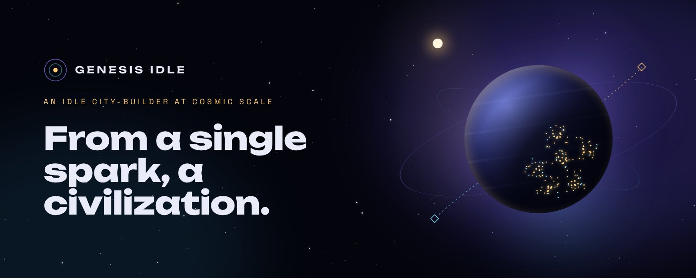
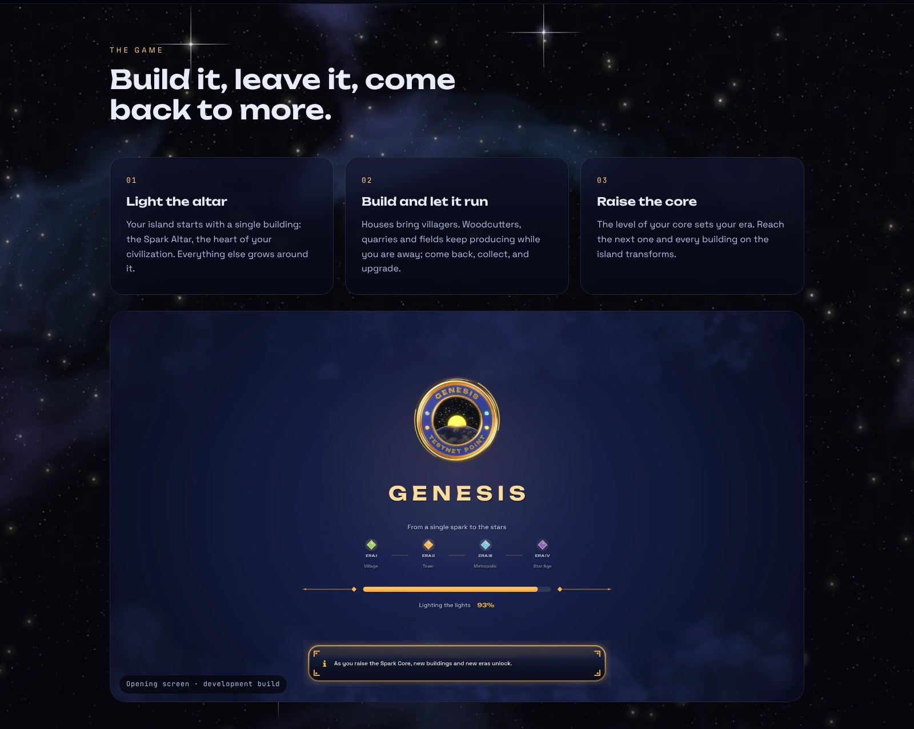
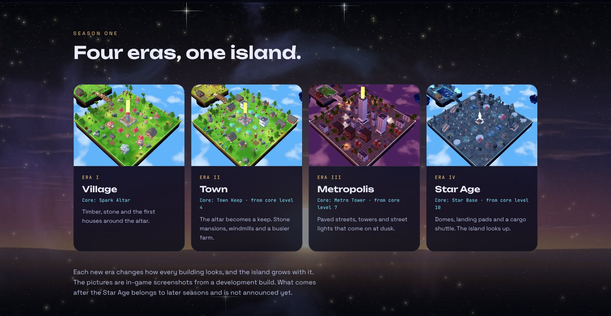
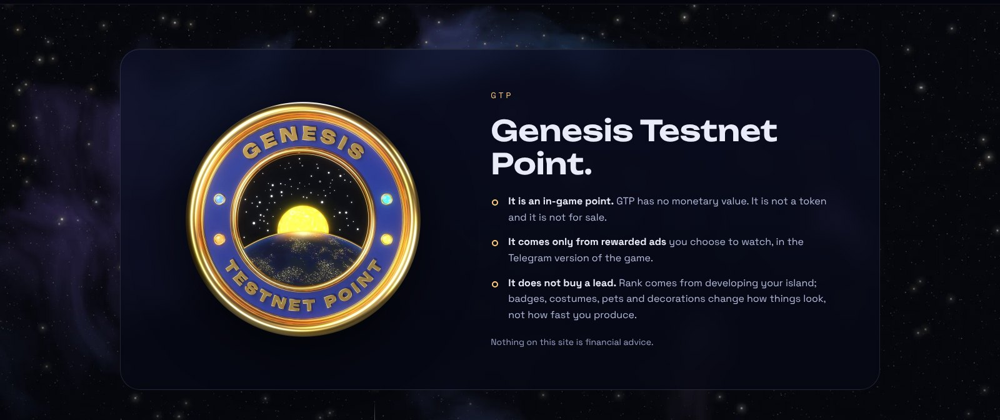
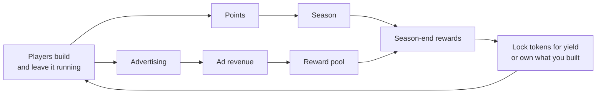

<p align="center">
  
</p>

# Genesis Idle

**From a single spark, a civilization.**

Genesis Idle is an idle civilization builder for the web and Telegram. You light the Spark Altar on an island of your own, leave the game running, and come back to something larger than you left. Behind the game sits a bigger plan: an ecosystem in which play, advertising revenue and on-chain ownership feed one another.

[Website](https://genesisidle.com)

> **Status:** in development. The website is live. The game itself has not launched, and everything under [The ecosystem](#the-ecosystem) is a plan, not a released product.

## Contents

- [The game](#the-game)
- [The ecosystem](#the-ecosystem)
- [Roadmap](#roadmap)
- [The website](#the-website)
- [Working with this repository](#working-with-this-repository)
- [Team](#team)
- [Rights](#rights)

## The game

### The idea

Idle games are about time. So are civilizations. Genesis Idle is built on one quiet idea: small decisions, given enough time, become worlds.

You plant. You leave. You return, and find something larger than you left behind.

### The core loop

1. **Light the altar.** Your island starts with a single building, the Spark Altar. Everything else grows around it.
2. **Build and let it run.** Houses bring villagers. Woodcutters, quarries and fields keep producing while you are away.
3. **Return.** Collect what has accumulated and spend it on new buildings and upgrades.
4. **Raise the core.** The level of the core sets your era. Reach the next one and every building on the island transforms.

<p align="center">
  
</p>

### Four eras in season one

| Era | Name | Core | What changes |
|---|---|---|---|
| I | Village | Spark Altar | Timber, stone and the first houses around the altar. |
| II | Town | Town Keep, from core level 4 | The altar becomes a keep. Stone mansions, windmills and a busier farm. |
| III | Metropolis | Metro Tower, from core level 7 | Paved streets, towers and street lights that come on at dusk. |
| IV | Star Age | Star Base, from core level 10 | Domes, landing pads and a cargo shuttle. |

What comes after the Star Age belongs to later seasons and is not announced yet.

<p align="center">
  
</p>

### Island life

Villagers and a day and night cycle, quests and relics, a farm island joined by a bridge, pets and decorations, island costumes, ranks and a leaderboard, other players' islands to visit, a mailbox and gift codes. The game is translated into 50 languages.

### GTP

GTP stands for Genesis Testnet Point. It is an in-game point with no monetary value. It comes only from rewarded ads a player chooses to watch, in the Telegram version of the game, and it does not buy a production advantage.

<p align="center">
  
</p>

## The ecosystem

Genesis Idle is designed as the foundation of a wider ecosystem, not as a stand-alone game. The model has four parts.

| Part | The plan |
|---|---|
| **Points** | The in-game measure of progress. You earn them by building and by letting the city run. |
| **Seasons** | Play is organised into seasons. Every season ends with rewards for its players. |
| **Advertising** | The game is planned to carry advertising. That revenue is meant to flow back into the reward side, which is what closes the loop. |
| **Crypto** | Planned integration with a blockchain: districts, landmarks and relics that can live on-chain, and token locking that pays a yield (APR) for the time tokens stay locked. |

### The loop



The aim is a loop that keeps itself going. Play creates attention, attention brings advertising income, that income funds rewards, and rewards give players a reason to keep building.

### Not announced yet

- The chain, and whether a wallet is needed to play
- The token, its supply, and the lock periods and rates
- How long a season lasts and how rewards are shared
- The platforms the game will run on
- A launch date

### A plain note on money

Nothing in this repository is financial advice or an offer of any kind. The rewards, yields and advertising model described here are design goals. They may change, and none of them is a promise of profit.

## Roadmap

| Stage | State |
|---|---|
| Website | Live |
| The game | In development |
| Seasons and season-end rewards | Planned |
| Advertising revenue loop | Planned |
| On-chain ownership and token locking | Planned |

No dates have been announced.

## The website

This repository holds the site at [genesisidle.com](https://genesisidle.com), exactly as it is deployed.

<p align="center">
  
</p>

### How it is built

- **No framework and no build step.** One HTML page, one stylesheet, one script.
- **Fast and sharp.** Backgrounds are pre-rendered images in sizes up to 4K, picked by the browser for the screen, images below the fold load lazily, and decorative animation pauses when it is off screen.
- **Works on a phone.** One-row header with a menu panel; cards fall to two columns and then one on narrow screens.
- **Keyboard and screen-reader friendly.** Skip link, visible focus, and text alternatives for every picture that carries meaning.
- **Respects reduced motion.** With that system setting on, nothing loops, the coin is a still image, and nothing is hidden.
- **Locked down.** A strict Content-Security-Policy with no inline scripts or styles, plus HSTS and related headers.
- **Search and sharing.** Canonical URL, Open Graph and Twitter cards, structured data, sitemap, and a real 404 page.

<p align="center">
  
</p>

## Working with this repository

| Path | What it is |
|---|---|
| `site/` | The static site: `index.html`, `assets/site.css`, `assets/site.js`, backgrounds, game screenshots and the coin under `assets/`, icons, the share image, `404.html`, `robots.txt`, `sitemap.xml` and `_headers`. |
| `wrangler.jsonc` | Cloudflare Workers static-assets configuration: the six domains, 404 handling, and the account the site belongs to. |
| `docs/` | Images used in this README. |

### Preview locally

Paths in the site are root-relative, so serve the folder instead of opening the file:

```
npx wrangler dev
```

or, without Node.js:

```
python -m http.server --directory site
```

### Deploy

You need Node.js and access to the Cloudflare account that owns the domains.

```
npx wrangler deploy
```

The account is pinned in `wrangler.jsonc`, so Wrangler refuses to deploy anywhere else.

## Team

- [@0xeondev](https://github.com/0xeondev) — founder
- [@sicilth13-bot](https://github.com/sicilth13-bot) — contributor

## Rights

© Genesis Idle. All rights reserved. This repository is public so the work can be seen; no license is granted to copy or reuse the code, design or text.
